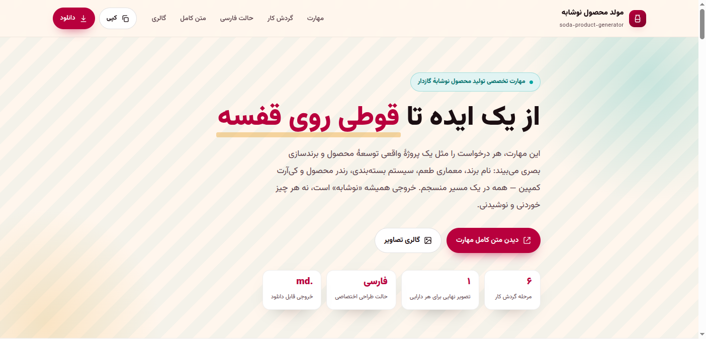

# مهارت طراحی بسته‌بندی نوشابه

این پروژه یک صفحهٔ فارسی و راست‌چین برای مشاهده و استفاده از مهارت طراحی بسته‌بندی نوشابه است. این مهارت فقط برای طراحی بسته‌بندی نوشابه‌های گازدار است و تمام نوشته‌های قابل‌مشاهده روی بسته را به خط فارسی محدود می‌کند.

## فایل‌های پروژه

- `index.html` — صفحهٔ تعاملی پروژه، شامل پیش‌نمایش مهارت، دکمه‌های کپی و دریافت فایل، و گالری تصاویر.
- `soda generator.md` — متن کامل و مستقل مهارت در قالب Markdown.
- `Gallery files/` — تصاویر محلی نمونه‌های بسته‌بندی که در گالری صفحه نمایش داده می‌شوند.
- `favicon.svg` — نشان نوشابه‌ای که در زبانهٔ مرورگر نمایش داده می‌شود.
- `ui-screenshot.png` — تصویر صفحهٔ پروژه.

## اجرای محلی

فایل `index.html` را در مرورگر باز کنید. نیازی به نصب وابستگی یا ساخت پروژه نیست. در صورت اتصال به اینترنت، صفحه قلم‌های لاله‌زار و مرزی تکست را برای ظاهر و متن فارسی از گوگل بارگذاری می‌کند و در صورت نبود اتصال از قلم‌های جایگزین دستگاه استفاده می‌شود.

## استفاده از مهارت

این صفحه راهنما و متن مهارت را در اختیار شما می‌گذارد؛ خود صفحه به‌تنهایی تصویر تولید نمی‌کند. برای به‌کارگیری مهارت، از یک دستیار هوش مصنوعی استفاده کنید که بتواند دستورالعمل متنی را دریافت کند.

۱. فایل `index.html` را در مرورگر باز کنید و در صفحه به بخش «متن کامل مهارت» بروید.
۲. دکمهٔ «کپی متن» را بزنید تا دستورالعمل مهارت کپی شود؛ یا «دانلود .md» را انتخاب کنید تا فایل مهارت را دریافت کنید. اگر دکمه‌ها کار نکردند، فایل `soda generator.md` را باز کنید و متن آن را دستی کپی کنید.
۳. در گفت‌وگوی تازه با دستیار، متن کپی‌شده را بچسبانید. اگر امکان بارگذاری فایل دارید، می‌توانید فایل Markdown را به‌جای آن پیوست کنید. اگر دستیار شما امکان نصب مهارت را دارد، فایل را طبق راهنمای همان سرویس به‌عنوان مهارت اضافه کنید.
۴. پس از فرستادن دستورالعمل، در همان گفت‌وگو توضیح دهید چه بسته‌ای می‌خواهید. لازم نیست همهٔ جزئیات را بدانید؛ فقط طعم و نوع ظرف را بگویید تا دستیار بقیه را پیشنهاد کند.
۵. طرح پیشنهادی را بررسی کنید و تغییرهای دلخواهتان را در همان گفت‌وگو بخواهید؛ مثلاً رنگ را عوض کنید، نام فارسی دیگری پیشنهاد دهید یا طرح را برای بطری تنظیم کنید.

### نمونهٔ درخواست

متن زیر را پس از دستورالعمل مهارت برای دستیار بفرستید و جزئیاتش را به سلیقهٔ خود تغییر دهید:

> برای یک نوشابهٔ گازدار با طعم انار و لیمو، بسته‌بندی قوطی باریک طراحی کن. سبک آن امروزی و پرانرژی باشد و از قرمز اناری، سبز لیمویی و نقش‌های هندسی الهام‌گرفته از هنر ایرانی استفاده کند. نام برند و تمام نوشته‌های روی قوطی را خودت به فارسی پیشنهاد بده. ابتدا ایده و متن دقیق روی بسته را بنویس و سپس، اگر امکان تولید تصویر داری، تصویر بسته‌بندی را بساز.

### نکته‌های کاربردی

- برای نتیجهٔ دقیق‌تر، نام یا حال‌وهوای برند، طعم، نوع ظرف (قوطی یا بطری)، مخاطب و رنگ‌های دلخواه را مشخص کنید. هر موردی را نمی‌دانید، به دستیار بسپارید.
- اگر فقط ایده و متن می‌خواهید، همان را درخواست کنید؛ برای ساخت تصویر، دستیار باید قابلیت تولید تصویر داشته باشد. در غیر این صورت می‌تواند شرح طراحی یا دستور تصویری آماده کند تا در یک ابزار تصویرساز استفاده کنید.
- نوشته‌های روی بسته باید فارسی باشند. از دستیار بخواهید متن دقیق روی بسته را جداگانه ارائه کند و هیچ نوشتهٔ انگلیسی یا ساختگی داخل تصویر نگذارد. نوشته‌های تولیدشده در تصویر را پیش از استفاده بررسی کنید؛ ابزارهای تصویرساز ممکن است حروف را نادرست نمایش دهند.
- عملکرد این مهارت روی مدل‌های مختلف تصویر ممکن است متفاوت باشد؛ هر مدل در خوانایی فارسی، جزئیات بسته و ترکیب‌بندی نتیجه‌ای متفاوت می‌تواند ارائه دهد.
- گالری صفحه فقط برای دیدن نمونه‌هاست. با دکمهٔ «افزودن تصویر» می‌توانید تصویرهای دستگاهتان را موقتاً در همان صفحه ببینید؛ این کار فایل را به پروژه اضافه یا در وب منتشر نمی‌کند.

این مهارت فقط برای طراحی بسته‌بندی نوشابه‌های گازدار است و پوستر، تبلیغ یا محصولی غیر از نوشابه تولید نمی‌کند. اطلاعات تغذیه‌ای، مجوزها و ادعاهای سلامت را نیز نباید بدون تأیید معتبر روی بسته درج کرد.